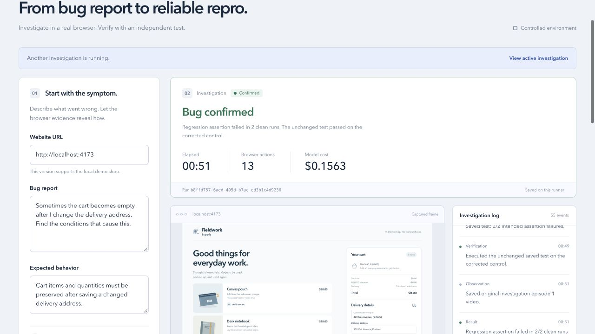
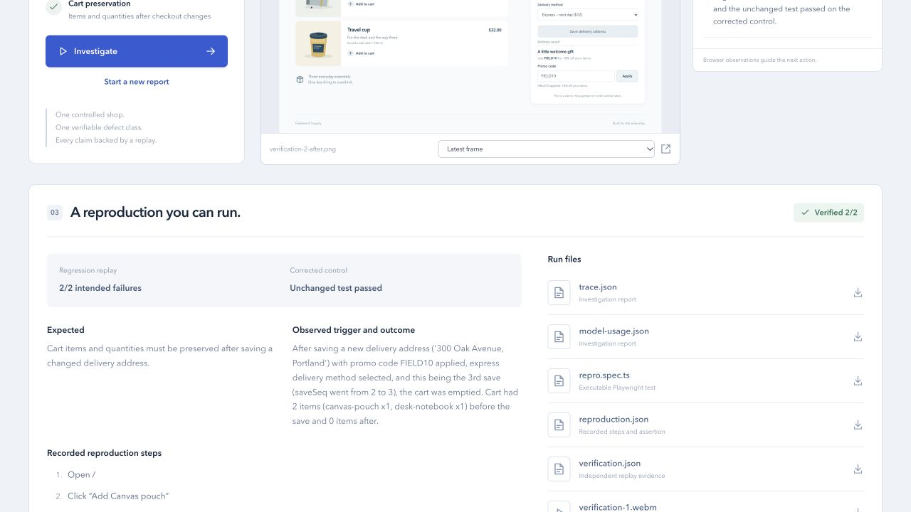

# First independently verified real model discovery — 12 October 2026

**Selected run `b8ffd757-6aed-405d-b7ac-ed3b1c4d9236` satisfies the controlled-shop proof contract:** a real model-directed browser investigation, two independent intended cart-preservation assertion failures, and a passing automatic corrected-control replay of the byte-identical saved test. This is one selected successful case, not a claim that every investigation succeeds.

| Identity | Verified value |
| --- | --- |
| Source commit recorded in trace | `2b541b20a97ef3df4261529bd48089792e01f2af` |
| Model | `claude-sonnet-4.6` |
| Neatlogs trace ID | `9096d7e75454f94d4c9cd11011604e13` |
| Local RunView | `http://127.0.0.1:5173/?run=b8ffd757-6aed-405d-b7ac-ed3b1c4d9236` (local services required; verified URL query routing) |
| Saved test SHA-256 | `bd9c42ba5744e7ed47cec25dcc47dd0341f9c7da88d034a700014b4a169c208a` |
| Real investigation | 13 browser actions; 16 model calls; 51.651 s terminal elapsed time |
| Tokens, all calls | 41,069 input + 1,261 output; includes the invalid response |
| Gateway accounting | $0.1563342, summed `x-litellm-response-cost` headers; invoiced cash/credits unknown |

## Inspect the proof

- [Saved Playwright test](repro.spec.ts), [reproduction.json](reproduction.json), [report.md](report.md), [trusted complete action log](action-log.json), [trace identity](trace.json), [all-call usage ledger](model-usage.json), [saved RunView](run.json).
- [Two buggy attempts](verification.json): both `matched_failure`, `BUGREPLAY_CART_PRESERVATION`, `assertionReached=true`, `contextClosed=true`, exit 1. Distinct nonces and Playwright start times establish separate replay processes. The checkpoint contains two products at quantity 1 each; after the completed changed-address save, both runs have an empty cart. The final sequence is 3, the address changed, `saved=true`, and `busy=false`.
- [Automatic corrected-control attempt](control-verification.json): one `passed`, exit 0; the same two products and quantities remain after the same step 13 and completed save. The verifier deliberately summarizes any non-bug outcome as `verdict=not_matched`; here the attempt's explicit `classification=passed` is the success evidence.
- Persisted [buggy attempt 1 config](verification-attempt-1-89220626/playwright.config.mjs), [buggy attempt 2 config](verification-attempt-2-011b6312/playwright.config.mjs), and [control config](candidate-1/control/verification-attempt-1-f278fd40/playwright.config.mjs) all select the exact same `repro.spec.ts`. The candidate copy has the identical SHA-256. The runner changes `BASE_URL` for the control and does not rewrite the saved test. Invocation timeouts, evidence directories and nonces necessarily differ between independent processes. Secret-bearing environment variables were not archived.
- The saved 13 steps exactly match the full trusted browser-action log from this clean episode, beginning with navigation and adding the cart items. The original model request contains only the generic symptom, expected behavior, target URL and oracle. The discovered combination appears in browser actions and the resulting artifact, not in the complaint.

[Buggy before 1](verification-1-before.png) · [Buggy after 1](verification-1-after.png) · [Buggy before 2](verification-2-before.png) · [Buggy after 2](verification-2-after.png) · [Control before](control-before.png) · [Control after](control-after.png).

## Preservation and independent checks

Original bundle was preserved at **15:29:02 UTC before any manual replay**: `artifacts/archives/first-real-confirmed-original-20261012T152902Z.tar.gz` (12,529,922 bytes; 70 original files), SHA-256 `ee64e0d3536763b43e73475c8a097a4c1cdaccbd08bf4d4886eb0bdd586035fd`. Source, staged copies, archive streams and the unchanged source snapshot were hash-checked. [Original manifest](original-manifest.json) lists every original file hash; the complete archive remains local and private.

At 15:30:50 UTC, all **27 registered API artifacts** returned HTTP 200, the declared MIME type and bytes matching local SHA-256. This includes all four buggy verification before/after PNGs, both replay videos, the original investigation video and control JSON. The live RunView exactly matched the preserved run JSON. Nested automatic-control media exist in the archive, but are not registered as RunView media; reviewed control PNG copies are included above.

All four unique original WebM videos fully decode with FFmpeg: investigation 49.64 s (1280×900), buggy replay 1 4.48 s, buggy replay 2 4.52 s, control 4.44 s (all replay videos 1280×720, VP9). All six proof PNGs and both product UI screenshots were visually reviewed: only the controlled demo and synthetic data are visible. Keyframes from each headless controlled-shop clip were visually reviewed (every 4 s investigation, every 1 s replays): only synthetic shop UI appears. The four byte-identical original clips are published below.

[Independent audit](audit.json) contains check results, raw Playwright report statistics, API hashes, media details and the original/public-copy hash mapping. `repro.spec.ts`, reproduction, trace, usage ledger, action log and images are byte-identical copies. Other text copies only remove local machine/home prefixes, including escaped regex forms; the original hashes remain recorded. No credentials, environment files, private conversation, or Entire transcript are included. Pattern scan found no credential strings or local home paths in public text.

## Limits

This proof concerns the configured cart-preservation oracle in the controlled shop. Other real attempts, including non-discoveries and earlier failures, must remain in the full-cohort record. A selected success is not the acceptance rate. The complete [fourth-series audit](../live-fourth-series-2026-10-12/README.md) records all three buggy runs and the fixed negative control.

Gateway headers are accounting evidence, not an invoice. The selected $0.1563342 LLM cost exceeds the $0.1293 variable-cost target for a $49/100 plan at 70% contribution margin; it implies about 64.5% contribution before other variable costs. Promotional credits and cash billing are unknown. This packet makes no cost-improvement claim.

This auditor did not run `npm run repro`. Any later manual control replay must use an isolated copied bundle/output and must not replace these automatic original results.

## Original videos and separate manual fixed replay

[Download original investigation WebM](investigation-episode-1.webm) · [Download buggy replay 1 WebM](verification-1.webm) · [Download buggy replay 2 WebM](verification-2.webm) · [Download automatic corrected-control WebM](control.webm). These are original, unedited headless-shop recordings; original hashes are in [audit.json](audit.json). GitHub may download WebM instead of previewing it.

After original preservation, the integrator copied the bundle into `artifacts/manual-control-2026-10-12` and ran `npm run repro -- --run b8ffd757-6aed-405d-b7ac-ed3b1c4d9236 --base-url http://localhost:4174`. The [separate manual fixed verification](manual-control/verification.json) passed with exit 0, assertion reached and context closed, the same step 13/saveSeq2→3, and cart 2→2. [Manual saved test](manual-control/repro.spec.ts) has the exact same SHA-256 as the original buggy test; no steps/assertion were modified. [Manual audit](manual-control/audit.json) verifies every one of the original 70 selected files remained unchanged, and records a separate archive of new/changed manual outputs plus the identical test. Copied unchanged duplicates were omitted from that archive only; no source files were deleted.

Manual-control archive: `artifacts/archives/manual-fixed-control-originals-20261012T153326Z.tar.gz`, 1,625,268 bytes, 14 files, SHA-256 `03cfc33a770b0cce36d3d7e214160c7caa5760397fd0bd49fba657d37284da3a`. The manual PNGs are byte-identical to the visually reviewed automatic fixed PNGs; the new manual video fully decodes. The full command is the integrator's recorded execution; the artifact audit independently verifies its resulting test and evidence.
