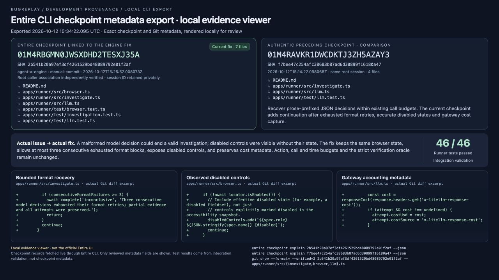
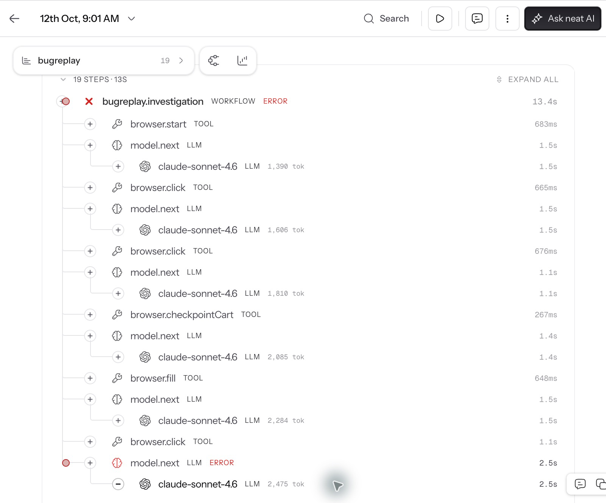
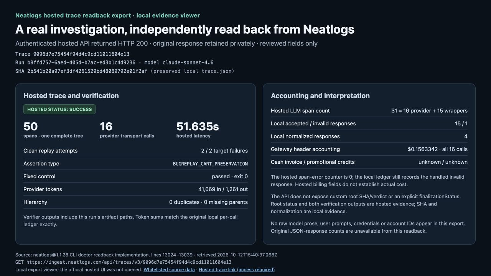
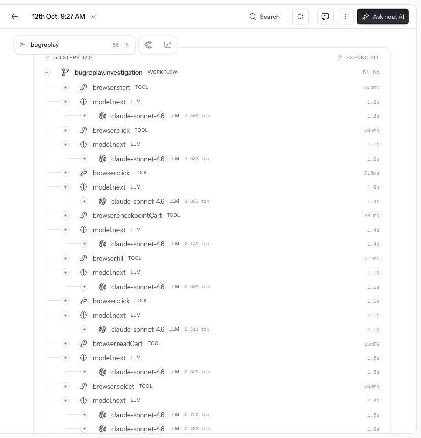
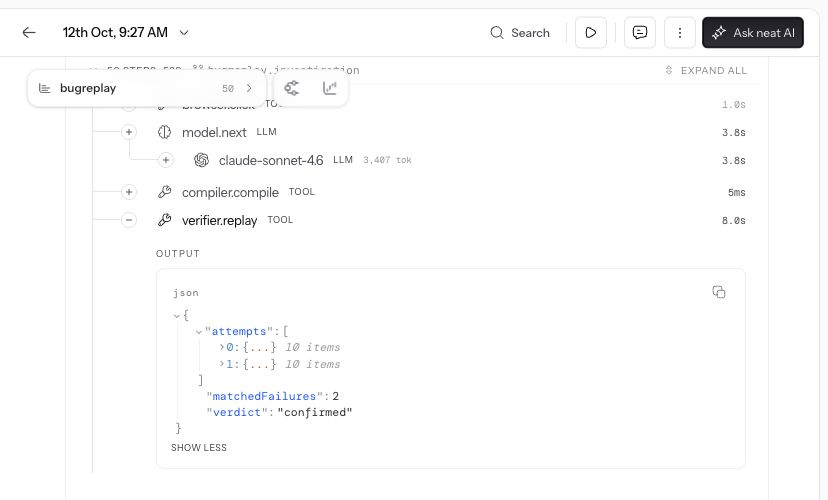
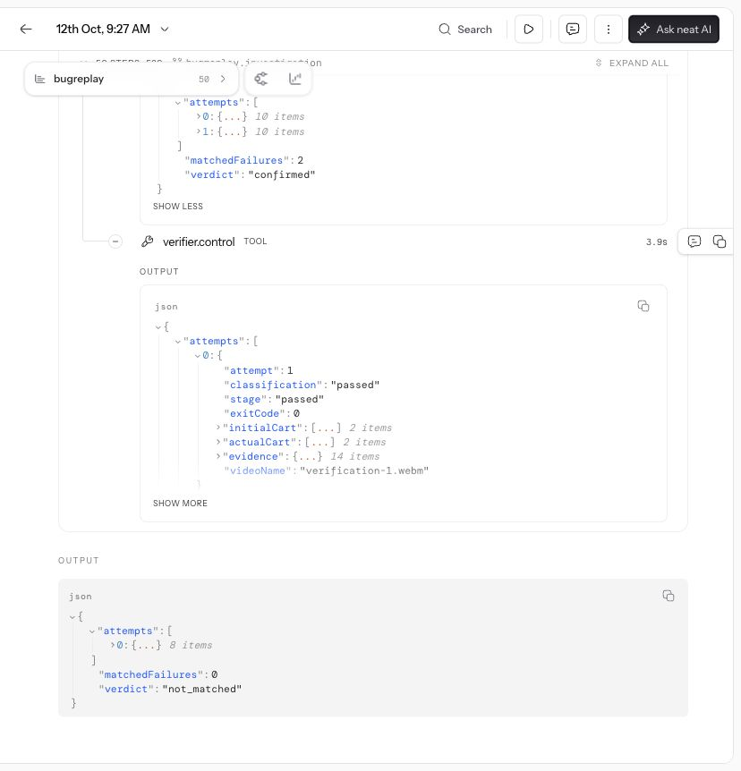

# Trace-guided engine improvements: reviewed stage history

Status: **Stage D now includes one independently confirmed real controlled-shop discovery (1/3 buggy runs), 2/2 intended assertion failures and the byte-identical test passing on the fixed control**. Earlier stages remain preserved below with their failures. No lower-cost or lower-latency claim is made. The [selected proof and originals](../live-confirmed-2026-10-12/README.md) and [complete fourth cohort](../live-fourth-series-2026-10-12/README.md) are separately audited.

## Four-run cohort comparison

Stage A is the first baseline at `60d22946616664235546ed81817f60ded57957db`; Stage C is the third series at `f7bee47c254afc38683b87ad6d30899f16180a47`. Each cohort contains **three buggy-shop investigations and one fixed-shop investigation**. The exact ordinary complaint, expected behavior, oracle and URL match by target, and the model is `claude-sonnet-4.6` throughout. No trigger recipe was added to the input.

| Metric | Stage A: first baseline | Stage C: third series |
| --- | ---: | ---: |
| Runs ending on response-format error / all cohort runs | 4 / 4 | 2 / 4 |
| Runs ending `not_reproduced` / all cohort runs | 0 / 4 | 2 / 4 |
| Runs ending `bug_confirmed` / all cohort runs | 0 / 4 | 0 / 4 |
| Total recorded browser actions across all four runs | 17 | 47 |
| Total run elapsed time across all four runs | 46.927 s | 192.929 s |
| Model transport attempts across all four runs | 21, from reports | 85, from per-call ledgers |
| Responses accepted through normalization / model attempts | Unsupported at this SHA | 33 / 85 |
| Recorded input / output tokens across all four runs | 28,506 / 893, incomplete | 226,554 / 6,166, all logged received responses |

The higher action, duration and token totals reflect deeper exploration and bounded repairs after early format failures, not improved cost or speed. The baseline omitted terminal invalid-response usage, so its token counters cannot support a complete token or dollar comparison. Commercial gateway costs for these earlier stages remain unknown.

The two `not_reproduced` outcomes are buggy-shop investigations that stopped without confirming a defect; they are not successful bug discoveries. The fixed-shop investigation remains inconclusive. Neither of these earlier cohorts produced a saved reproduction, 2/2 intended assertion failures or an unchanged passing control.

Configuration source is byte-identical between these stages: defaults of 40 browser actions, 40 model calls, four hypotheses, 360 seconds investigation, 120 seconds verification and 480 seconds total. The integrating agent reports the same run environment/budgets; source equality was independently checked. Original bundles did not persist historical environment overrides. The current local environment has no budget overrides. These are stochastic runs with four cases per stage, and the first-to-third comparison spans recording/accounting changes too; it is not an isolated ablation or a general success-rate estimate.

## Selected real case directly around the format fix

This separate selected-case comparison uses **Stage B** (`b8e9f7c`, second series) immediately before the fix and Stage C (`f7bee47`) after it. These independent runs have byte-identical CreateRun input, the same buggy URL/model, and complete received-response ledgers.

| Field | Before: Stage B | After: Stage C |
| --- | --- | --- |
| Run ID | `70582bba-ec4a-4d46-9846-ecc305ec36fb` | `5e7c759d-aedf-4102-b17c-a5f3ecff5104` |
| Trace | [f997c43d7542b0c7baefb66cd610fe33](https://app.neatlogs.com/traces/f997c43d7542b0c7baefb66cd610fe33) | [9a9a30c5ba6ca76fb6c5272c88303509](https://app.neatlogs.com/traces/9a9a30c5ba6ca76fb6c5272c88303509) |
| Outcome | inconclusive after format error | not_reproduced after further exploration |
| Browser actions | 5 | 16 |
| Model attempts | 6 | 24 |
| Normalized responses / attempts | 0 / 6 | 13 / 24 |
| Invalid responses / attempts | 1 / 6 | 1 / 24 |
| Elapsed | 17.465 s | 60.974 s |
| Input / output tokens | 11,250 / 323 | 65,169 / 2,195 |

The hosted before trace's Raw screenshot shows prose followed by an unfenced JSON `readCart` suffix; the provider succeeds while the wrapper rejects its format. The after ledger records 13 accepted normalized responses and continuation to a bounded `not_reproduced` outcome. Trace IDs above were checked against the original `trace.json` files. This is not deterministic replay of the same provider response. Hosted trace links may require account access. The latest confirmed after trace is now independently verified by authenticated hosted readback, as documented below; the official after UI was subsequently opened and independently reviewed in the supplementary captures below. Raw recordings and private conversations are not copied here.

## Actual fix and authentic Entire checkpoint

Fix commit: [`f7bee47c254afc38683b87ad6d30899f16180a47`](https://github.com/dsvyro1414-lab/bugreplay/commit/f7bee47c254afc38683b87ad6d30899f16180a47), parent `b8e9f7c995f021deb88e8e2acb8be38bb985ca1e`. The [actual source diff](format-recovery-f7bee47.patch) accepts one complete, unambiguous JSON suffix after prose and adds one bounded output-format repair. Ambiguous, truncated or trailing output still fails; repair uses the existing transport/call/time limits and does not echo rejected prose or add a bug recipe.

Entire checkpoint **`01M4RAVKR1DWCDKTJ3ZH5AZAY3`** was independently read with `entire checkpoint explain <id> --json`, matched to the existing saved metadata, and matched to the fix commit footer. [Reviewed safe checkpoint metadata](entire-checkpoint.safe.json) includes only the checkpoint/fix identity, strategy, branch, file/session/task counts and the source rationale. It contains no transcript, prompts, private conversation, session token records or raw recordings. This checkpoint records the real response-format change; its existence does not turn the remaining failed investigations into successful acceptance.

[comparison.json](comparison.json) contains the earlier eight and latest four cohort run identities, exact input hashes, trace/file hashes, denominator definitions, selected-case metrics and comparison limits. Original bundles remain separately preserved in the [first baseline](../live-baseline-2026-10-12/README.md), [second series](../live-second-series-2026-10-12/README.md) and [third series](../live-third-series-2026-10-12/README.md).

## Stage D: latest real cohort after observation and continuation changes

The fourth series at [`2b541b20a97ef3df4261529bd48089792e01f2af`](https://github.com/dsvyro1414-lab/bugreplay/commit/2b541b20a97ef3df4261529bd48089792e01f2af) contains the same three buggy URLs plus one fixed URL, ordinary complaint, expected behavior and model. Source budget defaults remain byte-identical. The system prompt and browser observation content changed: visible disabled control labels/states are now exposed without action refs, generic exploration guidance improved, and malformed output can produce a bounded tool error and continue rather than terminate the entire investigation. Gateway response-cost headers are now recorded for every call. [Actual source diff](observation-continuation-2b541b2.patch).

| Whole four-run cohort metric | Stage A | Stage C | Stage D |
| --- | ---: | ---: | ---: |
| Response-format terminal failures / all runs | 4/4 | 2/4 | 0/4 |
| Confirmed cases / all runs | 0/4 | 0/4 | 1/4 |
| Buggy discovery rate | 0/3 | 0/3 | 1/3 |
| Non-discovery outcomes / all runs | 0/4 | 2/4 | 3/4 |
| Fixed investigation | inconclusive | inconclusive | not_reproduced |
| Browser actions, all four runs | 17 | 47 | 68 |
| Elapsed seconds, all four runs | 46.927 | 192.929 | 253.941 |
| Model attempts | 21 reported | 85 ledger | 92 ledger |
| Accepted normalized responses | unsupported | 33/85 | 44/92 |

Latest ledgers contain four invalid responses among 92 calls; they are included in tokens/costs. One fixed-run event records an invalid decision remaining after its bounded repair, then continuation. None of the four terminal completed events reports a format failure. Three runs terminate `not_reproduced`; the selected case terminates `bug_confirmed`. Increased actions, elapsed time and tokens measure longer exploration; they do not demonstrate speed or cost improvement. Latest whole-cohort gateway accounting is $0.9546999, with cash billing/credits unknown. Earlier missing costs remain unknown.

The selected real before/after example is **70582bba / [trace f997c43d7542b0c7baefb66cd610fe33](https://app.neatlogs.com/traces/f997c43d7542b0c7baefb66cd610fe33)** at `b8e9f7c` → **b8ffd757 / [trace 9096d7e75454f94d4c9cd11011604e13](https://app.neatlogs.com/traces/9096d7e75454f94d4c9cd11011604e13)** at `2b541b2`. Before: format-terminated inconclusive, five actions, six calls, 17.465s. Latest: confirmed through independent test/control, 13 actions, 16 calls, 51.651s, four normalized decisions and one invalid response, all accounted. The CreateRun input is byte-identical. Hosted links may require access. Authenticated readback of the latest after trace is verified below; its hosted verification outputs agree with the original local proof. The official after UI was subsequently opened and independently reviewed in the supplementary captures below.

This is **multiple trace-guided engine changes with real checkpoints**, not an isolated single-change experiment. Stochastic outcomes, changed generic instructions/observations and tiny cohorts prevent attributing all discovery improvement to normalization alone. The latest source did not add the hidden target recipe to the runtime prompt; discovered checkout values appear in browser observations/actions and the saved result.

Authentic latest Entire checkpoint **`01M4RBGMN0JWSXDHD2TESXJ35A`** was independently verified using `entire checkpoint explain <id> --json`, matched to saved metadata and commit footer. [Latest safe checkpoint](entire-latest-checkpoint.safe.json) retains source identity/file/count metadata only; no Entire transcript, private conversation or session/task details. The earlier `f7bee47` checkpoint remains the correct checkpoint for unambiguous response-suffix normalization; the latest checkpoint covers generic observations, continuation and accounting.

## Reviewed Entire CLI export viewer

[Open local metadata viewer](latest-entire-local-viewer.html) · [Reviewed exported metadata](latest-entire-export.safe.json) · [Actual captured local viewer](latest-entire-local-viewer.jpg). This is a local evidence viewer populated from authentic Entire CLI checkpoint metadata and actual source diffs, **not the official Entire application UI**. The screenshot is a real capture of that local viewer. Test counts are integration validation reported by the integrator, not an Entire metadata field. Only reviewed checkpoint/source identities, file lists and diff excerpts are published; no conversation/transcript or token-accounting records are included.

## Genuine hosted before screen and after trace readback

[Reviewed before screenshot](neatlogs-before-parser-crop.png) is a reviewed crop of the actual Neatlogs UI (x=160, y=190, width=1600, height=1330; browser chrome and account sidebar excluded) for the **first baseline** trace [`17af3d753892ebeeff61afa08ee24492`](https://app.neatlogs.com/traces/17af3d753892ebeeff61afa08ee24492), run `e07bdfa3-c839-4e68-b784-640244403b2c`, SHA `60d22946616664235546ed81817f60ded57957db`. It shows the workflow/model wrapper error after successful provider spans. It is a different before example from the immediate Stage B comparison above. The original Raw-response screenshots remain private because they include exploratory model prose.

[Open hosted-data export viewer](neatlogs-after-evidence.html) · [Whitelisted hosted readback and local reconciliation](neatlogs-after-safe.json) · [Actual captured export viewer](neatlogs-after-hosted-export.jpg). These after materials come from an authenticated **HTTP 200 hosted Neatlogs readback**, retrieved `2026-10-12T15:40:37.068Z` using the exact GET path implemented by the installed `neatlogs@1.1.28` CLI doctor: `/api/traces/v3/9096d7e75454f94d4c9cd11011604e13`. No guessed endpoint or new access grant was used. Raw source is retained privately; the public export contains only reviewed counts, identities and verification classifications.

The hosted trace has status `success`, 50 unique spans, one root, no missing parents, **16 provider calls**, and **41,069 input / 1,261 output tokens**, exactly matching the complete original local ledger. Hosted `verifier.replay` output contains two intended `BUGREPLAY_CART_PRESERVATION` failures; hosted `verifier.control` output contains a passing fixed replay with exit 0. Both contain this selected run's artifact paths. Hosted `llmCalls=31` counts 16 provider spans plus 15 `model.next` wrappers; it does **not** mean 31 billable calls.

The hosted route omits custom root Git SHA/verdict and explicit `finalizationStatus`. SHA comes from the preserved local `trace.json`, joined by the same trace/run identity; the hosted child verification outputs establish the replay/control results. Four normalized responses and one handled invalid response come from the local per-call ledger, while the hosted span-error counter is zero. Hosted billing fields and response-string representations do not establish actual dollar cost or byte-identical raw JSON-response counts. The actual selected gateway-header total is $0.1563342; invoice and credits remain unknown.

The after image is a real capture of a **local viewer of hosted Neatlogs data**, not the official Neatlogs UI. No raw model output, private prompts, account IDs, headers or credentials are included.

## Supplement: actual official Neatlogs after UI

After the final movies were rendered, the integrator opened the selected trace in authenticated Chrome and captured the **actual official Neatlogs UI**. All three saved JPEG crops were independently visually reviewed; the account sidebar is excluded and raw model exploration is not expanded. [Safe capture audit](neatlogs-after-official-ui-audit.json) retains selected run/trace/source identity, crop bounds and hashes.

- [Official overview](neatlogs-after-official-overview.jpg): 50 spans and a displayed 51.6-second workflow.
- [Official replay output](neatlogs-after-official-replay.jpg): `matchedFailures: 2`, `verdict: confirmed`.
- [Official fixed-control output](neatlogs-after-official-control.jpg): attempt 1, `classification: passed`, `stage: passed`, exit 0, two initial and two actual cart items.

These screenshots supplement the authenticated API reconciliation and original local assertion evidence. The trace/run association comes from the browser operator's selected live trace, the safe audit and matching hosted/local identities; the crop intentionally excludes the address bar. **Both final movie files remain unchanged:** their Neatlogs after scene truthfully shows the earlier authenticated hosted-data export viewer. The new official UI captures were collected after montage and are separate evidence.

